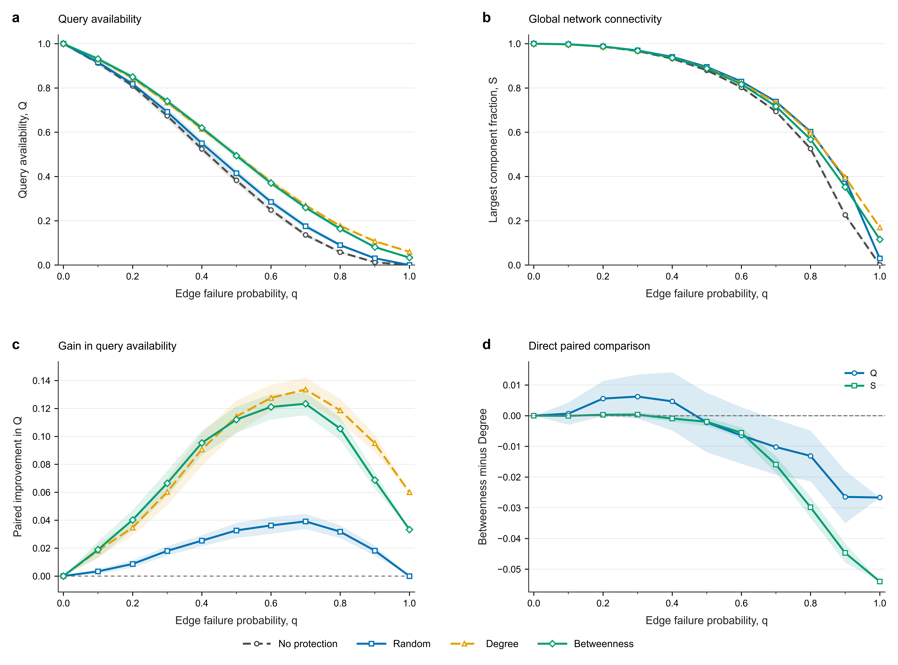

# Part D: Edge Protection Results and Discussion

This document reports the completed Part D experiment. The frozen protocol and implementation are documented in [Part D selection](part_d_selection.md) and [Part D handoff](part_d_handoff.md). All numerical tables below are calculated from the committed `results/part_d/analysis/` outputs; the original experimental observations are in `results/part_d/full/runs.csv`.

## 1. Research question and design

We ask whether network-informed protection preserves short-range concept associations under random edge failures better than random protection. The fixed, undirected, unweighted ConceptNet subgraph has **1,000 nodes and 3,417 edges**. Each of Random, Degree and Betweenness protects **170 edges** (the floored 5% budget); None protects no edges. Random uses a single seed-2026 protection set; Degree ranks edges by endpoint-degree sum; Betweenness ranks by exact normalized unweighted edge betweenness. All rankings use the original graph and deterministic tie-breaking.

The workload consists of 150 fixed queries (75 originally at distance 2 and 75 at distance 3). The same stored potential failure values are used for all four strategies within each trial and failure probability q. The full design covers 11 q values (0.0 to 1.0 by 0.1), 30 trials per q and 4 strategies: **1,320 scenarios**. The 60-scenario pilot and full experiment completed with program-reported validation passing.

The main metrics are:

- **Q:** fraction of the 150 fixed queries still reachable within three hops after failure.
- **S:** number of nodes in the largest connected component divided by 1,000.

These are structural metrics; Q is not a measure of semantic question-answering accuracy.

## 2. Statistical methods

For each strategy and q, we calculate the mean, sample standard deviation (denominator n−1) and two-sided pointwise 95% Student's t interval over the 30 trials. Protected-versus-None improvements are calculated **within matching trial/q pairs before averaging**. Relative improvement divides the mean paired gain by the mean None baseline, when that baseline is positive. We also directly compare Betweenness minus Degree using matched trial/q differences.

The trial is the repeated unit. Across q values, the same trial's underlying saved failure-uniform row is reused, so the 330 observations per strategy are not 330 independent replicates. Confidence intervals describe uncertainty conditional on this fixed graph, query set and protection sets; they do not cover variation from reselecting Random edges or resampling graphs. They are not corrected for multiple comparisons.

## 3. Query availability (Q)

| q | Metric | None | Random | Degree | Betweenness |
| --- | --- | ---: | ---: | ---: | ---: |
| 0.2 | Q | 0.8096 | 0.8182 | 0.8442 | 0.8498 |
| 0.3 | Q | 0.6740 | 0.6920 | 0.7342 | 0.7404 |
| 0.4 | Q | 0.5247 | 0.5500 | 0.6153 | 0.6200 |
| 0.7 | Q | 0.1360 | 0.1751 | 0.2696 | 0.2593 |
| 0.9 | Q | 0.0124 | 0.0307 | 0.1076 | 0.0811 |
| 1.0 | Q | 0.0000 | 0.0000 | 0.0600 | 0.0333 |

At q=0.4, mean Q rises from 0.5247 (None) to 0.5500 (Random), 0.6153 (Degree) and 0.6200 (Betweenness). The relative improvements against None are approximately **4.83%**, **17.28%** and **18.17%**, respectively. Thus, both structure-informed selections have substantially higher mean query availability than Random in this moderate-failure setting.

At q=0.9, Degree retains mean Q=0.1076 versus Betweenness=0.0811, Random=0.0307 and None=0.0124. At q=1.0, only protected edges remain: Degree retains Q=0.0600 and Betweenness Q=0.0333, while Random and None have Q=0. The strategy ranking therefore changes with failure severity.

## 4. Largest connected component (S)

| q | Metric | None | Random | Degree | Betweenness |
| --- | --- | ---: | ---: | ---: | ---: |
| 0.4 | S | 0.9325 | 0.9407 | 0.9374 | 0.9364 |
| 0.7 | S | 0.6939 | 0.7383 | 0.7329 | 0.7169 |
| 0.9 | S | 0.2269 | 0.3885 | 0.3969 | 0.3522 |
| 1.0 | S | 0.0010 | 0.0300 | 0.1700 | 0.1160 |

The rankings differ from Q. At q=0.4, Random has the largest mean S (0.9407), while Betweenness has the largest mean Q (0.6200). At q=0.9 and q=1.0, Degree has the highest mean S among the four strategies. Preserving short paths for the fixed query workload and retaining a large global component are related but different objectives. Mean rankings alone do not establish significant differences between strategies.

## 5. Direct Betweenness–Degree comparison

The paired difference is Betweenness minus Degree. Positive values favor Betweenness; negative values favor Degree.

| q | Mean paired ΔQ | Pointwise 95% CI |
| --- | ---: | --- |
| 0.2 | +0.00556 | [-0.00018, 0.01130] |
| 0.3 | +0.00622 | [-0.00097, 0.01341] |
| 0.4 | +0.00467 | [-0.00483, 0.01417] |
| 0.7 | -0.01022 | [-0.01923, -0.00122] |
| 0.9 | -0.02644 | [-0.03501, -0.01788] |

At q=0.2–0.4, Betweenness has a slightly higher mean Q, but all three pointwise confidence intervals contain zero; the data do not establish a clear average advantage over Degree there. At q=0.7 and 0.9, the unadjusted pointwise intervals exclude zero and favor Degree. These are descriptive, conditional comparisons without multiple-testing correction, not claims of a universally superior strategy.

At q=1.0, all unprotected edges are removed. For each fixed protection set, Q and S are deterministic across trials; repeated trials at this endpoint do not add independent failure-realization information.

## 6. Recorded computational costs

| Strategy | Mean damage + evaluation time per scenario (ms) | Recorded one-time selector time (ms) |
| --- | ---: | ---: |
| None | 28.06 | 0.00 |
| Random | 29.45 | 2.00 |
| Degree | 32.25 | 3.81 |
| Betweenness | 32.55 | 6.70 |

Per-scenario times are the sums of `damage_seconds` and `evaluation_seconds`, averaged over 330 scenarios per strategy. They exclude separate input verification, selection auditing and other setup overhead. The selector times are single measurements from `results/part_d/selection/selection_metadata.json`, not controlled benchmarks. **The Betweenness selector time excludes the cost of computing exact edge betweenness from scratch**, since a precomputed cache was used. The two timing columns have different scopes and must not be added to claim a complete end-to-end runtime.

## 7. Interpretation and limitations

Network-informed protection can substantially improve fixed-workload short-path availability under moderate random failures. However, Betweenness does not dominate across q, and Q and S do not always favor the same strategy. One possible explanation is that Degree retains locally connected structures useful after severe failures, whereas original-graph shortest-path importance may not remain predictive after extensive edge removal. This mechanism is a **hypothesis**, not directly established by the present metrics; protected-subgraph and path-level analysis would be needed to test it.

Key limitations are: one seed-neighborhood-based ConceptNet sample; an undirected simple-graph projection that omits semantic and directional information; one fixed set of 150 queries; one 170-edge protection budget; static rather than adaptive protection; independent random potential failures rather than targeted or correlated failures; a single fixed Random protection allocation; conditional trial uncertainty; unadjusted multiple comparisons; and selector timing that omits full betweenness preprocessing. The experiment therefore supports conclusions about this structural workload, not downstream reasoning accuracy or general performance on all knowledge graphs.

## 8. Conclusion

For the frozen ConceptNet subgraph and fixed 150-query workload, Degree and Betweenness protection preserve short-range query availability more effectively than Random at moderate failure probabilities. Betweenness has slightly higher mean Q at q=0.2–0.4, without a clear paired difference from Degree at those q values; Degree performs better under severe failures. Global connectivity S can rank strategies differently from query availability Q. The results support **metric- and failure-regime-dependent** edge protection rather than a universal best strategy.

## 9. Figure and reproducibility



**Figure 1.** (a) Mean query availability Q; (b) mean largest connected component fraction S; (c) mean trial-paired improvement in Q against None; (d) trial-paired Betweenness minus Degree differences for Q and S. All panels cover 11 failure probabilities and use 30 paired trials per q. Shaded regions are pointwise 95% Student's t confidence intervals, conditional on the fixed graph, workload and protection sets. Protected strategies each use 170 edges.

Run the following from the repository root in the required Python environment to regenerate the analysis and figure from the saved full experiment:

```bash
python scripts/analyze_protection.py
python scripts/plot_protection.py
```

The scripts read `results/part_d/full/runs.csv` and the recorded selection metadata; they do not modify frozen experimental inputs. The primary supporting tables are `summary.csv`, `paired_improvements.csv`, `direct_comparisons.csv`, `timing_summary.csv` and `key_comparisons.csv` under `results/part_d/analysis/`.
